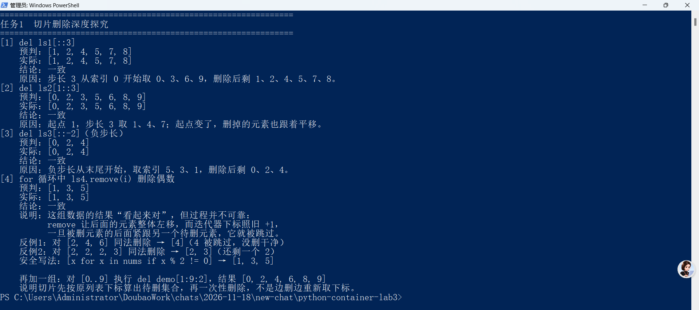
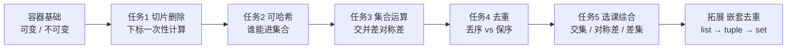
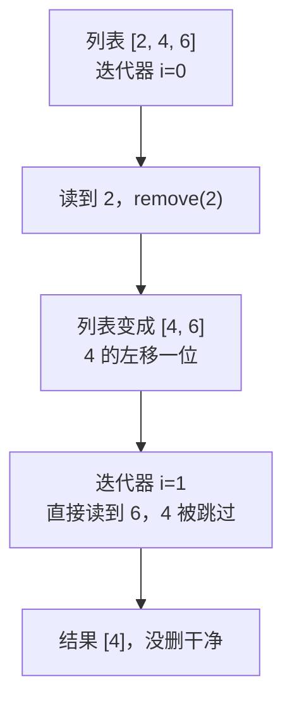

# 实验 3：列表、元组、集合——那些“看起来对、其实靠运气”的写法

> 实验目标一句话：把三个最熟的容器，拆到内存和哈希表的层面，看清它们各自的边界。
> 最终结果：5 个任务 + 1 个拓展全部跑通，22 条 pytest 用例全绿，8 张截图全部来自本机终端真实运行。

仓库：<https://github.com/Hanna2126/python-container-lab3>



## 1. 为什么这个实验值得认真做

列表、元组、集合是 Python 里最早学会、也最容易被“用顺手”掩盖细节的三个东西。平时写代码只要结果对，很少有人追问：`del ls[::3]` 到底删的是哪几个下标？为什么 `(1, [2, 3])` 不能放进集合，但 `t[1].append(4)` 又完全合法？`list(set(data))` 去重之后顺序为什么变了？

这三个问题分别对应三块知识：**切片与原地删除的执行顺序**、**可哈希的判定规则**、**集合的哈希表本质**。这次实验就是围绕它们展开的，任务从验证到综合设计，最后落到一个“两个班选课名单”的小场景。

先看整体路线：



## 2. 任务 1：`del ls[::3]` 到底删了谁

指导书要求先写预判再运行。我先把四组结果写在纸上，再让程序打印实际值，逐条对照：

| 操作 | 预判 | 实际 | 结论 |
| --- | --- | --- | --- |
| `del ls1[::3]`，`ls1=[0..9]` | `[1,2,4,5,7,8]` | `[1,2,4,5,7,8]` | 一致，删下标 0、3、6、9 |
| `del ls2[1::3]` | `[0,2,3,5,6,8,9]` | `[0,2,3,5,6,8,9]` | 一致，删下标 1、4、7 |
| `del ls3[::-2]`，`ls3=[0..5]` | `[0,2,4]` | `[0,2,4]` | 一致，删下标 5、3、1 |
| 循环 `remove` 偶数，`[1..6]` | `[1,3,5]` | `[1,3,5]` | 一致，但只是碰巧 |

关键在“一次性”三个字。解释器先用 `slice.indices(len)` 把 `start/stop/step` 归一化成合法下标，算出待删位置集合，再统一搬移内存。**不是删一个、后面重排、再按新下标删下一个**。如果真是动态索引，删掉 0 之后原来的 1 会变成下标 0、原来的 3 变成下标 2，接下来“隔 3 个删一个”就会删到另一批元素。为了再验证一次，我又跑了一组 `del demo[1:9:2]`，删的是 1、3、5、7，结果 `[0,2,4,6,8,9]`，同样说明下标在操作前就定好了。

负步长也一样：`ls3[::-2]` 先从末尾取 5，再取 3，再取 1，删除仍然是一次性的，所以剩 `[0,2,4]`。

### 循环删除的坑：`[1,3,5]` 只是运气好

第四组结果看起来“把偶数都删干净了”，但它靠的是数据排列。对 `[1,2,3,4,5,6]`，删掉 2 之后 4 正好补到迭代器下一步要访问的下标上，所以 4 也被访问到，6 同理。换成连续偶数立刻暴露：

```python
ls = [2, 4, 6]
for i in ls:
    if i % 2 == 0:
        ls.remove(i)
# 实际结果：[4]
```

删掉 2 后列表变成 `[4, 6]`，迭代器下标加一后指向 6，4 被跳过。`[2, 2, 2, 3]` 同理会剩一个 2。

原因不复杂：`for` 用的是索引迭代器，`remove` 让后面的元素整体左移一位，而迭代器下标照旧 `+1`，被删元素后面那个元素就再也不会被检查。



安全写法有四类，实验里选了第一种：

```python
# 1. 列表推导式重建
nums = [x for x in nums if x % 2 != 0]
# 2. 倒序按索引删
for i in range(len(nums) - 1, -1, -1):
    if nums[i] % 2 == 0:
        del nums[i]
# 3. 遍历副本，删原表
for x in nums.copy():
    if x % 2 == 0:
        nums.remove(x)
# 4. filter
nums = list(filter(lambda x: x % 2 != 0, nums))
```

## 3. 任务 2：可哈希是进入集合的入场券

五组测试，两条成功、三条报错，异常信息原样保留：

| 写法 | 结果 | 理由 |
| --- | --- | --- |
| `s.add((1, 2, 3))` | 成功 | 元组不可变，三个元素都是 int，整体可哈希 |
| `s.add((1, [2, 3]))` | `TypeError: unhashable type: 'list'` | 元组里有 list，list 可变，整个元组跟着不可哈希 |
| `s.add([1, 2])` | `TypeError: unhashable type: 'list'` | list 内容一变哈希就变，不允许进集合 |
| `s.add(frozenset({1, 2}))` | 成功 | 冻结集合，内容不可变、哈希固定 |
| `s.add({1, 2})` | `TypeError: unhashable type: 'set'` | 普通 set 可变，本身不可哈希 |

最终集合里只剩两类对象：纯 int 元组和 frozenset。

```python
s = {(1, 2, 3), frozenset({1, 2})}
```

需要“集合套集合”时，正确写法是 `{frozenset({1,2}), frozenset({2,3})}`，取回普通集合用 `set(fs)`。注意 `frozenset()` 是空集合，`{}` 是空字典，这两个别混。

这里最容易误解的一点是“元组不可变”。`t = (1, [2, 3])` 里 `t[1].append(4)` 完全合法，因为改的是元组指向的那个列表，元组里保存的引用地址没变；但 `hash(t)` 要对每个元素求哈希，list 不可哈希，所以 `t` 进不了集合。**不可变是引用层面的事，可哈希是内容层面的事。**

## 4. 任务 3：集合运算其实是在做集合代数

```python
A = {2, 4, 6, 8, 10, 12}
B = {3, 6, 9, 12, 15}
```

| 运算 | 结果 | 含义 |
| --- | --- | --- |
| `A & B`（交集） | `{6, 12}` | 两边都有 |
| `A ∪ B`（并集） | `{2,3,4,6,8,9,10,12,15}` | 至少属于一边 |
| `A - B`（差集） | `{2,4,8,10}` | 在 A 不在 B |
| `B - A`（差集） | `{3,9,15}` | 在 B 不在 A |
| `A ^ B`（对称差） | `{2,3,4,8,9,10,15}` | 只属于一边（= 并集减交集） |

集合推导式生成 1～30 内 4 的倍数：

```python
comp = {x for x in range(1, 31) if x % 4 == 0}
# {4, 8, 12, 16, 20, 24, 28}
```

另外用 `(A | B) - (A & B)` 交叉验证了一遍，结果与 `A ^ B` 相同。差集方向很容易反，写 `B - A` 和 `A - B` 前最好先在纸上标清楚“在左边、不在右边”。

## 5. 任务 4：去重的三种写法，快的和保序的往往不是同一个

原始数据 `[5, 2, 7, 2, 5, 9, 7, 3, 9, 1]`：

| 方案 | 结果 | 特点 |
| --- | --- | --- |
| `list(set(data))` | `[1, 2, 3, 5, 7, 9]` | 最快，但丢顺序；这组小整数看着像升序只是 `hash(i) == i` 的巧合 |
| 手写循环 | `[5, 2, 7, 9, 3, 1]` | 保序，逻辑直观，但整体 O(n²) |
| `list(dict.fromkeys(data))` | `[5, 2, 7, 9, 3, 1]` | 保序，O(n)，写法最短 |

再补一组 20 万条随机整数的耗时对比：

| 方案 | 耗时（本次运行） |
| --- | --- |
| `list(set(data))` | 5.3 ms |
| 手写循环 | 3719.3 ms |
| `dict.fromkeys` | 5.4 ms |

手写循环慢三个数量级，原因就在 `item not in out`——每次判断都要线性扫描输出列表。数据量一大，这条写法就不能要了。保序 + 高效的正确选择是 `dict.fromkeys`，或者“集合做 seen、列表做输出”的组合。

## 6. 任务 5：两份选课名单，五步算清楚

```python
class1 = [101, 103, 105, 107, 109, 103, 101]
class2 = [102, 104, 106, 108, 109, 107, 102]
```

1. **各自保序去重**：1 班 `[101,103,105,107,109]`（7 条去重后 5 人），2 班 `[102,104,106,108,109,107]`（7 条去重后 6 人）。
2. **同时选两门**：`s1 & s2 = {107, 109}`，共 2 人。
3. **只选一门**：对称差 `{101,102,103,104,105,106,108}`，共 7 人，把两边都有的 107、109 排除掉。
4. **只选 1 班**：`s1 - s2 = {101,103,105}`，共 3 人。
5. **交集转元组**：`tuple(sorted(both)) = (107, 109)`。交集里都是 int，int 可哈希，所以元组也可哈希，能继续放进集合或当字典键。

第五步我额外做了个验证：`{(107,109), ('x',1)}` 可以正常创建，说明元组确实可用作集合元素。顺带把编号映射成姓名，输出“同时选两门：赵七、钱九”“只选 1 班：张一、李三、王五”，比一串数字好读。

## 7. 拓展：嵌套列表怎么去重

`nest = [[1,2], [3,4], [1,2], [5,6]]`，内层 list 不可哈希，不能直接扔进 set。思路是先把内层转成 tuple 当键，输出仍保留 list 形态：

```python
seen, out = set(), []
for item in nest:
    key = tuple(item)
    if key not in seen:
        seen.add(key)
        out.append(item)
# [[1,2], [3,4], [5,6]]
```

如果只需要集合结果，直接 `{tuple(x) for x in nest}` 即可；要还原成列表再套一层 `list()`。

## 8. 踩坑记录

| 现象 | 原因 | 处理 |
| --- | --- | --- |
| 终端里 `s1 ^ s2` 的 `^` 被字体渲染成一个空隙，看着像 `s1  s2` | 控制台字体对某些符号渲染不佳 | 输出改用 `s1.symmetric_difference(s2)`，说明里再提运算符写法 |
| 手写循环去重跑 20 万条要 3.7 秒 | `not in` 是线性扫描，整体 O(n²) | 换 `dict.fromkeys`，5.4 ms |
| `list(set(data))` 的输出看着像升序，误以为它保序 | 小整数 `hash(i) == i`，槽位顺序刚好接近升序 | 换字符串或大整数复测，并写明“不保证顺序” |
| 循环删偶数第一组结果正确，差点以为没 bug | 数据排列恰好让被删元素后面紧跟的元素补位 | 增加 `[2,4,6]`、`[2,2,2,3]` 两个反例 |

第 3 条和第 4 条是这次实验最有价值的部分：**一次正确的运行结果，不能证明逻辑正确**。判断一段代码是否可靠，要看它在什么条件下会失效，而不是只看手里这份数据。

## 9. 五道思考题速答

1. **`del ls[::3]` 按删除前索引还是实时索引？** 删除前一次性算好。`[0..9]` 删 0、3、6、9，剩 `[1,2,4,5,7,8]`；`del ls[1:9:2]` 删 1、3、5、7，剩 `[0,2,4,6,8,9]`。
2. **`t=(1,[2,3])` 为什么 `t[1].append(4)` 合法，但 t 不能进集合？** 前者改的是引用指向的列表，元组引用没变；后者要对每个元素求哈希，list 不可哈希，`hash(t)` 直接报 `unhashable type: 'list'`。
3. **为什么 set 不能嵌套，frozenset 可以？** set 可变，内容一变哈希失效；frozenset 冻结，哈希固定，可作元素或键。
4. **for + remove 为什么删不干净？** 删除导致左移，迭代器下标却继续加一，紧跟其后的元素被跳过。安全做法是推导式重建、倒序删除、遍历副本。
5. **`list(set())` 去重有什么缺陷？保序怎么做？** 丢顺序、要求元素可哈希。保序用 `dict.fromkeys`、手写 `not in` 循环，或“set 判重 + list 输出”。

## 10. 怎么跑起来

```bash
git clone https://github.com/Hanna2126/python-container-lab3.git
cd python-container-lab3

python run_all.py                     # 一键跑完 5 个任务 + 拓展
python -m src.task1_slice             # 单独跑某个任务
python -m pytest tests -v             # 22 条用例
```

目录：

```text
python-container-lab3/
├─ run_all.py
├─ src/            # 6 个任务模块
├─ tests/          # 22 条 pytest 用例
├─ 截图/           # 8 张真实运行截图
├─ blog/           # 本文与配图
├─ 实验报告.docx
└─ README.md / 验证记录.md
```

## 结语

做完这五个任务，我对三个容器的印象从“会用”变成了“知道边界在哪”：切片和 `del` 都是按下标办事，可哈希是进入集合的门票，去重前要先问自己“顺序要不要”。这三个判断，比记住多少个方法更有用。
